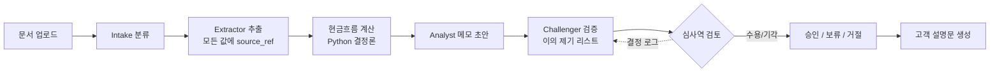
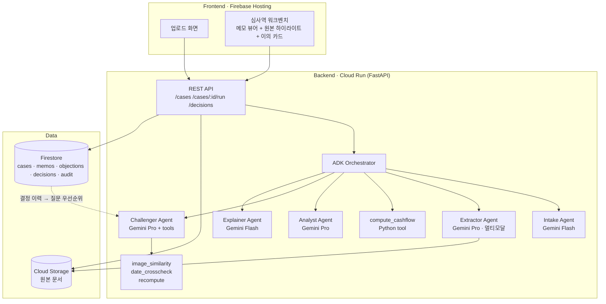

# LedgerLens 기획서 (AI Builder Cup 2026 · BFSI)

작성일: 2026-10-14 · 작성자: Changhyeon

> 작업용 기획 스냅샷. 제출물(덱, 코드, README, 영상)은 전부 **영어**로 만든다.

---

## 0. 한 줄 요약

LedgerLens는 신용기록이 없는 APAC 소상공인의 비정형 자료(거래내역 PDF, 셀러 대시보드 캡처, 종이 영수증, 가게 사진)를 Gemini 멀티모달로 읽어 **모든 숫자가 원본 증거에 링크된 심사 메모**를 만들고, 별도의 **챌린저 에이전트**가 그 메모를 적대적으로 검증한 뒤 심사역이 최종 승인하는 대출 심사 에이전트다.

USP 한 문장(덱 표지/영상 도입부 그대로 사용):
**"The first credit memo where every number can be clicked back to its source, and a second AI tries to break it before a human signs."**

핵심 일정
- 프로토타입 제출 마감: **2026-10-18**
- 평가 기간: 2026-10-19 ~ 11-06 (Cloud Run 인스턴스 유지 필요)
- 본선 발표: 2026-11-07
- Grand Finale (싱가포르 Demo Day): 2026-12-04

---

## 1. 문제 정의

동남아 소상공인은 자료가 없어서가 아니라 자료가 **비정형이라서** 대출을 못 받는다. 인도네시아, 베트남, 필리핀의 영세 사업자 다수는 신용평가사 기록이 없는 thin-file 고객이다. 대신 모바일뱅킹 거래내역 PDF, Shopee/Tokopedia 셀러 대시보드 캡처, 종이 영수증 뭉치, 매장 사진처럼 형식이 제각각인 자료는 가지고 있다.

은행과 핀테크 대부업자 입장에서 이 자료를 사람이 읽어 심사하면 건당 비용이 소액대출 마진을 넘어선다. 선택지는 거절하거나, 자료를 보지 않고 고금리로 빌려주거나 둘뿐이었다.

기존 자동화 시도의 한계
- 전통 OCR + 룰 기반 추출: 문서 포맷이 은행마다, 플랫폼마다 달라 유지보수가 끝나지 않는다.
- 단일 LLM에 "이 문서 보고 심사해": 환각된 숫자가 메모에 섞여도 심사역이 잡아낼 방법이 없다. 규제 산업에서 치명적.
- 대안 신용평가 ML 모델(통신 데이터, 심리 측정): 블랙박스라 거절 사유를 고객에게 설명하기 어렵고 감독기관 설명 의무와 충돌.

풀어야 할 문제는 "문서를 읽는 것"이 아니라 **"읽은 결과를 심사역과 감독기관이 믿을 수 있게 만드는 것"**이다.

규모감 참고 수치(개략치, 덱에서는 IFC MSME Finance Gap / World Bank Findex 최신판으로 재확인): 동남아 MSME 약 7천만 개 이상, 상당수가 공식 금융 접근 제한.

---

## 2. 솔루션 개요와 USP

LedgerLens는 "작성자와 검증자를 분리한 심사 에이전트 팀"이다.

핵심 메커니즘 3가지
1. **증거 연결(Evidence Linking)**: 메모의 모든 숫자는 `문서 ID + 페이지 + bbox`를 가진다. 클릭하면 원본 해당 줄이 하이라이트된다. 근거 없는 숫자는 구조화 출력 스키마에서 강제로 막는다.
2. **챌린저 에이전트(Challenger Agent)**: 1차 메모를 받아 적대적 질문 목록을 실행한다. 중복 계상, 계절성, 영수증 이미지 중복, 대시보드 기간 vs 거래내역 기간 불일치 등. 결과는 심각도가 붙은 "이의 제기(Objection)" 리스트.
3. **사람의 결정이 데이터가 된다**: 심사역은 각 이의를 수용/기각하고 최종 승인한다. 결정은 Firestore에 쌓여 다음 챌린저 질문 우선순위가 된다. 감사 로그 자동 생성.

| 비교 대상 | 그들이 하는 것 | LedgerLens가 다른 점 |
| --- | --- | --- |
| OCR 기반 추출 (Document AI 단독) | 정형 양식에서 필드 추출 | 양식 없는 캡처·사진·손글씨를 Gemini 멀티모달로 한 번에 해석 |
| 단일 LLM 심사 챗봇 | 문서 요약과 점수 | 작성자/검증자 분리, 숫자마다 원본 좌표, 환각 차단 스키마 |
| 대안 신용평가 ML | 통신·행동 데이터로 점수 | 점수가 아니라 사람이 읽는 메모, 거절 사유를 고객에게 설명 가능 |
| PitchLense (Gen AI Exchange 2025 우승작) | 투자자용 스타트업 분석 | 대출 심사라는 규제 영역, 금융 포용 임팩트, 챌린저 검증 구조 |

---

## 3. 핵심 기능 목록

| 기능 | 설명 | 우선순위 | 기술 |
| --- | --- | --- | --- |
| 멀티모달 문서 업로드 | PDF, JPG/PNG, 스크린샷을 한 케이스로 묶어 업로드 | Must | Firebase Hosting + Cloud Storage |
| 문서 분류와 추출 | 유형 자동 판별 후 구조화 추출, 각 값에 페이지·좌표 부착 | Must | Gemini 멀티모달 + JSON schema |
| 현금흐름 모델 | 월별 유입/유출, 매출 추세, 변동성, 장부 외 수입 추정 | Must | Python(결정론적), Gemini는 분류만 |
| 증거 연결 심사 메모 | 모든 숫자가 원본 위치로 링크, 클릭 시 하이라이트 | Must | Gemini + 스키마 강제, React 뷰어 |
| 챌린저 에이전트 | 적대적 검증, 이의 제기 리스트 | Must | ADK 멀티에이전트 + 도구(이미지 해시, 날짜 교차검증, 재계산) |
| 심사역 워크벤치 | 이의 수용/기각, 승인/보류/거절, 사유 입력 | Must | React + Firestore |
| 감사 로그 | 에이전트 호출, 프롬프트 버전, 결정 기록 | Should | Firestore + Cloud Logging |
| 고객용 설명문 | 승인/거절 사유를 현지어로 쉽게 | Should | Gemini 다국어 |
| 피드백 루프 | 심사역 결정을 챌린저 질문 우선순위에 반영 | Should | Firestore 집계 + 프롬프트 주입 |
| 포트폴리오 대시보드 | 여러 건 처리 현황, 이슈 통계 | Later | BigQuery + Looker Studio |
| LOS 연동 API | 여신 시스템에 결과 밀어넣는 REST | Later | Cloud Run API |

제외: 실제 신용점수 산출, 금리 책정, 실제 은행 API 연동 → Future Development 슬라이드로.

---

## 4. 프로세스 플로우

윗줄은 문서가 메모가 되는 과정, 아랫줄은 메모가 검증되고 사람이 결정하는 과정. 사용자는 둘: 대출 담당자(또는 소상공인 본인)가 업로드, 심사역이 결정.

---

## 5. 아키텍처 (Google Cloud)

구성 요소
| 레이어 | 선택 | 이유 |
| --- | --- | --- |
| Frontend | React (Vite) + Firebase Hosting | 템플릿 요구사항(Firebase 배포) 충족, PDF/이미지 뷰어 라이브러리 풍부 |
| Backend | Python FastAPI on Cloud Run | ADK가 Python 우선, Cloud Run 요구사항 충족 |
| Agent runtime | Google ADK (Agent Development Kit) | 멀티에이전트 오케스트레이션, 도구 호출, 심사위원이 아는 스택 |
| Models | Gemini Pro 계열(Extractor, Analyst, Challenger), Gemini Flash 계열(Intake, Explainer) | 정확도 vs 비용. 제출 시점 최신 GA 버전으로 확정 |
| Storage | Cloud Storage(원본), Firestore(케이스/메모/결정/감사) | 빠른 셋업, 실시간 UI 업데이트 |
| 관측 | Cloud Logging + 프롬프트 버전 태그 | 감사 추적 스토리 |
| 배포 | Cloud Run min-instances=1 (평가 기간) | 콜드 스타트 방지 |

---

## 6. 에이전트 설계

| 에이전트 | 역할 | 입력 | 출력(구조화) | 도구 |
| --- | --- | --- | --- | --- |
| Intake | 문서 유형 분류, 품질 체크, 언어 감지 | 파일 목록 | `{doc_id, type, language, quality_flags[]}` | 없음 |
| Extractor | 문서별 구조화 추출. 모든 값에 `source: {doc_id, page, bbox}` 필수 | 이미지/PDF | `transactions[]`, `sales_summary[]`, `receipts[]`, `premises_observations[]` | 없음 |
| Analyst | 현금흐름 결과를 읽고 메모 초안. 숫자는 계산 모듈 결과만 인용 | 추출 결과 + 현금흐름 테이블 | `memo: {sections[], figures[{value, source_refs[]}], recommendation}` | `compute_cashflow()`, `lookup_sector_benchmark()` |
| Challenger | 메모 적대적 검증. 고정 질문 12개 + 케이스별 생성 질문 | 메모 + 원본 추출 결과 | `objections[{id, severity, claim, evidence_refs[], suggested_action}]` | `image_similarity()`, `date_crosscheck()`, `recompute()` |
| Explainer (Should) | 최종 결정을 고객 언어로 설명 | 결정 + 사유 | `customer_letter: {language, text}` | 없음 |

챌린저 고정 질문 12개
1. 매출이 거래내역과 셀러 대시보드에서 중복 계상되지 않았나
2. 월별 매출 변동이 업종 계절성으로 설명되나, 아니면 일회성 유입인가
3. 대형 입금 중 본인 계좌 간 이체(자기 송금)는 없나
4. 영수증 이미지가 동일 케이스 내 또는 과거 케이스와 중복되지 않나 (해시 + 임베딩 유사도)
5. 셀러 대시보드 캡처 기간이 거래내역 기간과 일치하나
6. 거래내역 잔액 연속성이 맞나 (전일 잔액 + 입금 - 출금 = 당일 잔액)
7. 지출 중 기존 대출 상환으로 보이는 정기 이체가 있나
8. 사진 속 매장 규모가 주장된 매출 규모와 상식적으로 맞나
9. 메모의 모든 숫자가 실제로 source_ref를 가지나 (누락 시 자동 Critical)
10. 월말 매출 집중 패턴이 비정상적이지 않나
11. 문서 간 사업자명·계좌명·주소가 일치하나
12. 추출된 언어·통화가 주장된 사업장 소재지와 맞나

프롬프트 원칙
- 숫자는 모델이 계산하지 않고 도구가 계산한다.
- 구조화 출력 스키마에서 `source_refs` 필수 필드 → 근거 없는 주장을 형식적으로 차단.
- Challenger는 Analyst의 프롬프트를 보지 못하고 결과물만 본다(독립성).
- 모든 에이전트 호출은 프롬프트 버전과 함께 로그.
- temperature 0, 데모는 성공 런 녹화 + 라이브용 캐시 모드.

---

## 7. 합성 데이터 계획

실제 고객 데이터는 쓰지 않는다. 가상 소상공인 3곳 + **챌린저가 잡아야 할 함정 20개**를 심는다. 함정 목록 = 벤치마크 정답지(`traps.json`).

| 케이스 | 업종/지역 | 문서 구성 | 정답 판단 | 역할 |
| --- | --- | --- | --- | --- |
| A. Warung Ibu Sari | 식료품 소매, 자카르타 | 모바일뱅킹 거래내역 6개월 PDF, 종이 영수증 사진 15장, 매장 사진 2장 | 승인 | 정상 케이스: 증거 연결 정확도 시연 |
| B. Linh Fashion Online | 의류 온라인 셀러, 호치민 | 거래내역 6개월, Shopee 대시보드 캡처 6장, 물류 영수증 | 보류(조건부 승인) | 함정 케이스: 함정 14개 |
| C. Reyes Auto Repair | 자동차 정비, 마닐라 | 거래내역 4개월(2개월 누락), 손글씨 장부 사진 8장, 정비소 사진 | 거절 또는 추가 자료 요청 | 불완전 자료 케이스: 함정 6개 |

함정 20개 유형
| 유형 | 개수 | 예시 |
| --- | --- | --- |
| 중복 계상 | 4 | 대시보드 매출과 거래내역 정산 입금이 같은 돈 |
| 자금 순환 | 4 | 본인 타행 계좌 입금 3건, 가족 계좌 왕복 1건 |
| 문서 조작·재사용 | 4 | 동일 영수증 날짜만 바꿔 2번, 대시보드 팔로워 수 불일치 |
| 기간·정합성 불일치 | 4 | 잔액 연속성 깨짐 2건, 대시보드 기간 vs 거래내역 기간 어긋남 2건 |
| 숨겨진 부채 | 4 | 매월 같은 날 같은 금액 이체(기존 대출) |

생성 방법: 거래내역은 Python으로 잔액 연속성 맞는 표 생성 후 함정 주입 → ReportLab/HTML→PDF로 은행 양식처럼 렌더. 셀러 대시보드는 HTML 목업 스크린샷. 영수증·매장 사진은 직접 촬영 또는 Imagen. 모든 합성 데이터에 "SYNTHETIC · FOR DEMO" 워터마크, README에 명시.

TODO
- [ ] 케이스 A 문서 생성
- [ ] 케이스 B 문서 + 함정 14개
- [ ] 케이스 C 문서 + 함정 6개
- [ ] `traps.json` 정답지

---

## 8. 벤치마크 계획

| 지표 | 정의 | 측정 | 목표 |
| --- | --- | --- | --- |
| 추출 정확도 | 거래 행 금액·날짜 정합 비율 | 합성 원본 CSV vs 추출 JSON | ≥97% |
| 증거 연결 정확도 | 메모 숫자의 source_ref가 실제 원본 위치를 가리키는 비율 | 수기 검증(약 60개) | ≥95% |
| 함정 적중률(Recall) | 20개 중 챌린저가 이의 제기한 수 | `traps.json` 대조 | ≥16/20 |
| 오탐률 | 정상 케이스 A에서 발생한 이의 제기 비율 | | ≤20% |
| 환각 숫자 | source_ref 없거나 원본과 다른 숫자 | 스키마 검증 + 수기 | 0 |
| 처리 시간 | 업로드 → 챌린저 결과 | Cloud Run 로그 | ≤3분/케이스 |
| 건당 비용 | 토큰 비용 + Cloud Run | 토큰 카운트 × 단가 | ≤USD 0.50 |

기준선: 같은 문서를 **단일 프롬프트(챌린저 없이 Analyst만)**로 돌렸을 때의 함정 적중률·환각 수를 나란히 → "왜 에이전트를 분리했는가"의 숫자 증거. 벤치마크 슬라이드의 핵심.

---

## 9. 4일 실행 계획

| 날짜 | 백엔드/에이전트 | 프론트 | 데이터/덱/영상 | 종료 기준 |
| --- | --- | --- | --- | --- |
| Day 1 (10/15 수) | GCP 프로젝트, Cloud Run 스켈레톤, ADK 셋업, Extractor 1종(거래내역 PDF) 동작 | Firebase 호스팅, 업로드 화면, 케이스 목록 | 케이스 A 문서 생성, 덱 영어 골격 | 거래내역 PDF 업로드 → 구조화 JSON 반환 |
| Day 2 (10/16 목) | Intake, Extractor 전 유형, compute_cashflow, Analyst 메모 생성 | 메모 뷰어 + 숫자 클릭 → 원본 하이라이트 | 케이스 B·C 문서 + 함정 20개 + traps.json | **케이스 A end-to-end 메모 생성** (안 되면 챌린저 질문 12→6으로 축소) |
| Day 3 (10/17 금) | Challenger + 도구 3종, 결정 저장, 피드백 루프, Explainer | 이의 카드 수용/기각, 승인 화면, 고객 설명문 | 벤치마크 실행, 단일 프롬프트 기준선 측정 | 함정 적중률 숫자 확보, 스냅샷 4장 |
| Day 4 (10/18 토) | 안정화, min-instances, 캐시 모드, README | UI 다듬기 | 영상 녹화·편집(3분), 덱 완성·PDF, 제출 | **제출 완료** (마감 당일 저녁 이전 목표) |

역할 분담(팀 구성 확정 후 조정): 백엔드/에이전트 1~2명, 프론트 1명, 데이터·덱·영상 1명.

---

## 10. 심사기준 매핑

| 심사 항목 | 비중 | 어필 포인트 | 근거 슬라이드 |
| --- | --- | --- | --- |
| Technical Merit & Gen AI Implementation | 40% | 멀티모달 비정형 문서 이해는 GenAI 없이 불가능. 작성자/검증자 분리 멀티에이전트. 구조화 출력으로 환각 차단. 단일 프롬프트 대비 벤치마크. Cloud Run 배포, 케이스당 비용으로 확장성 | 8 아키텍처, 9 기술, 12 벤치마크 |
| Problem Alignment & Impact | 25% | BFSI 테마의 리스크+프로세스 자동화+금융 경험 세 가지 동시. 동남아 thin-file 소상공인이라는 JAPAC 현안. 건당 심사 비용 숫자 | 3 아이디어, 4 기회, 13 향후 |
| Innovation & Creativity | 25% | 증거 연결형 메모와 챌린저 에이전트는 기존 해커톤 BFSI 출품작에 없던 구조. "AI가 AI를 검증하고 사람이 차이만 본다" | 4 USP, 6 플로우 |
| User Experience & Solution Design | 10% | 숫자 클릭 → 원본 하이라이트 한 가지 인터랙션에 집중. 이의 카드 수용/기각. 고객용 현지어 설명문 | 7 와이어프레임, 11 스냅샷 |

감점 회피: "AI가 대출을 결정한다"고 말하지 않는다 → "사람이 결정하고 AI는 증거를 정리한다". 신용점수 산출 주장 금지. 합성 데이터임을 숨기지 않는다.

---

## 11. 리스크와 대응

| 리스크 | 가능성 | 영향 | 대응 |
| --- | --- | --- | --- |
| 4일 안에 범위 못 끝냄 | 높음 | 치명적 | Must만 먼저. Day 2 저녁까지 케이스 A E2E 안 되면 챌린저 질문 12→6 |
| 손글씨 영수증 추출 정확도 저하 | 중간 | 중간 | 영수증은 "관찰 증거"로만, 현금흐름은 거래내역 기반. quality_flag 표시 |
| 챌린저가 함정 못 잡음 | 중간 | 높음 | 도구 호출(잔액 재계산, 이미지 해시)로 잡는 함정을 12개 이상으로 설계. 도구는 결정론적 |
| "합성 데이터라 의미 없다" 코멘트 | 중간 | 중간 | 함정이 실제 심사 체크리스트에서 왔음을 명시. 실데이터 파일럿 제안을 향후 계획에 |
| 모델 비결정성 | 높음 | 중간 | temperature 0, 스키마 강제, 성공 런 녹화, 라이브용 캐시 모드 |
| 영어 제출물 품질 | 낮음 | 중간 | 한국어로 확정 → 영어 번역 → 네이티브 감수 1회 |
| Cloud Run 콜드 스타트 | 높음 | 낮음 | min-instances 1, 평가 기간(10/19~11/6) 유지 |

---

## 12. 3분 데모 영상 스크립트

| 시간 | 화면 | 나레이션(영어 초안) |
| --- | --- | --- |
| 0:00~0:20 | 자카르타 시장 → 구겨진 영수증, 휴대폰 거래내역 캡처 | Across Southeast Asia, millions of small businesses are profitable but unbankable. Not because they lack records, but because their records look like this. |
| 0:20~0:40 | 심사역 책상, 거절 도장 | Reading these by hand costs more than the loan earns. So lenders say no, or lend blind. LedgerLens changes that. |
| 0:40~1:10 | 케이스 B 업로드, 메모 생성, 숫자 클릭 → 원본 하이라이트 | Upload a bank statement, a Shopee seller dashboard, a stack of receipts. Gemini reads them all and drafts a credit memo. Every number here is clickable. That revenue figure comes from this exact line, on this page. |
| 1:10~1:50 | 챌린저 실행, 이의 카드 3개 | Then a second agent tries to break the memo. It found the Shopee payouts were already in the bank statement, so revenue was double counted. It found a receipt image reused twice. And it found a monthly transfer that looks like an undisclosed loan. |
| 1:50~2:20 | 이의 2개 수용·1개 기각, 조건부 승인, 베트남어 설명문 | The underwriter decides. Accept two objections, dismiss one, approve with conditions. Every decision is logged and feeds back into the next review. The customer gets a plain-language explanation in her own language. |
| 2:20~2:45 | 벤치마크: 단일 프롬프트 vs LedgerLens | On our test set with 20 planted traps, a single prompt caught N. LedgerLens caught M, with zero unsourced numbers. Under three minutes and under fifty cents per case. |
| 2:45~3:00 | 아키텍처 한 장, 팀, GitHub | Built on Gemini, ADK and Cloud Run. Humans decide. AI shows its work. LedgerLens. |

N, M은 Day 3 벤치마크 결과로 채운다.

---

## 13. 제출 체크리스트와 템플릿 슬라이드 매핑

| 템플릿 슬라이드 | 내용 출처 | 비고 |
| --- | --- | --- |
| 1 Team Details | 팀명, 팀장, Problem Statement = BFSI | |
| 3 Brief about the idea | §0 | USP 문장 포함 |
| 4 Opportunities / USP | §1, §2 | 비교표 사용 |
| 5 List of features | §3 | Must/Should만 |
| 6 Process flow | §4 | |
| 7 Wireframes | 워크벤치 스케치 | UX 10% |
| 8 Architecture | §5 | |
| 9 Technologies | §5 표 | |
| 10 Estimated cost | §8 건당 비용 × 월 1만 건 | |
| 11 Snapshots | 실제 화면 4장 | 업로드, 메모+하이라이트, 이의 카드, 승인 |
| 12 Benchmarking | §8 결과 + 단일 프롬프트 비교 | |
| 13 Future Development | Later 기능 + 실데이터 파일럿 | |
| 14 Links | GitHub, YouTube, Cloud Run URL | |

제출 전 확인
- [ ] Cloud Run URL 비로그인 접근, 데모 케이스 3개 프리로드
- [ ] GitHub 공개 레포: README(영어), 아키텍처 그림, 실행 방법, 합성 데이터 고지
- [ ] 영상 3분 이내, 공개 링크, 자막
- [ ] 덱 PDF 변환, 전부 영어, 템플릿 순서 유지
- [ ] 코드 주석·변수명 영어
- [ ] API 키·서비스 계정 키 레포에 없음
- [ ] Cloud Run min-instances 1, 예산 알림
- [ ] Hack2skill 대시보드에서 카테고리 BFSI 선택 확인

---

## 참고 링크
- AI Builder Cup Themes & Requirements: https://aibuildercup.com/themes.html
- AI Builder Cup Overview: https://aibuildercup.com/
- Gen AI Exchange Hackathon Finale (수상작): https://blog.hack2skill.com/gen-ai-exchange-hackathon-finale
- ADK Hackathon winners: https://cloud.google.com/blog/products/ai-machine-learning/adk-hackathon-results-winners-and-highlights
