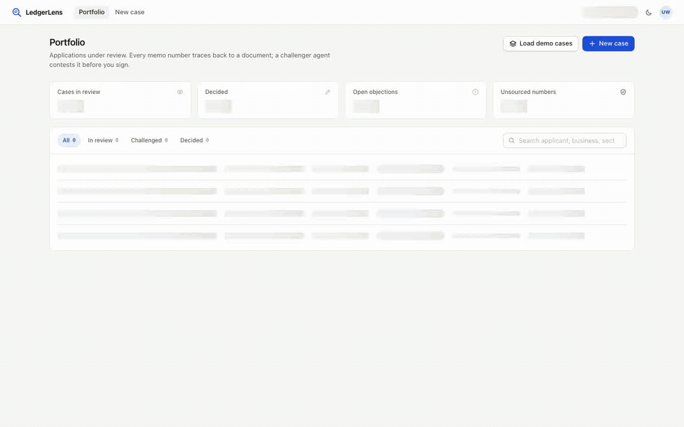
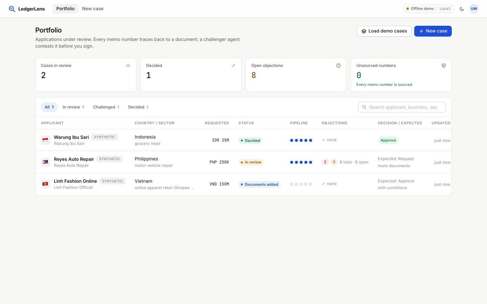
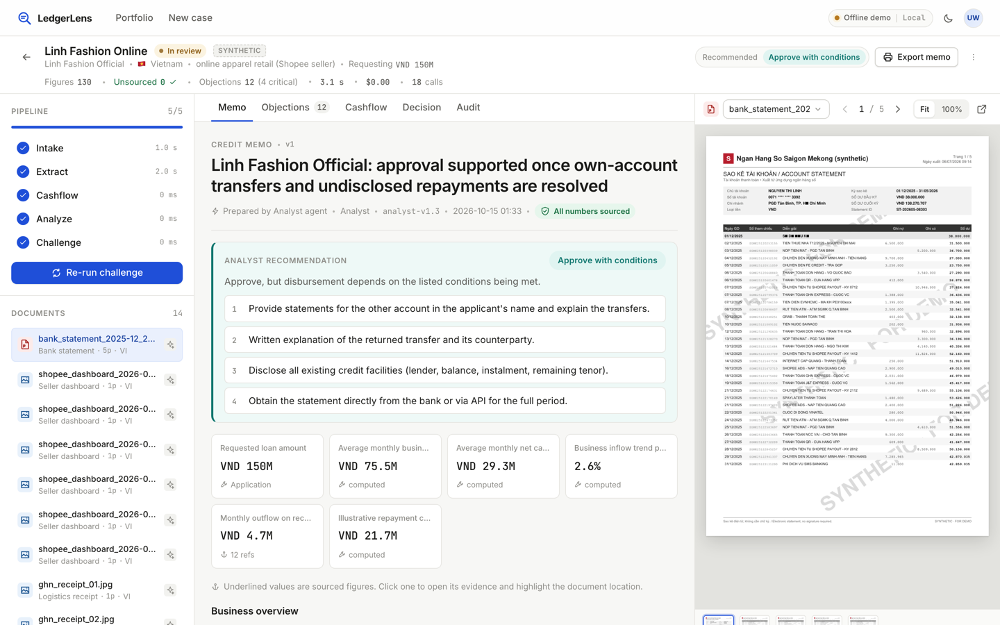
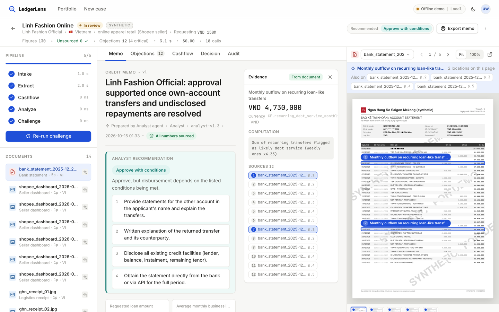
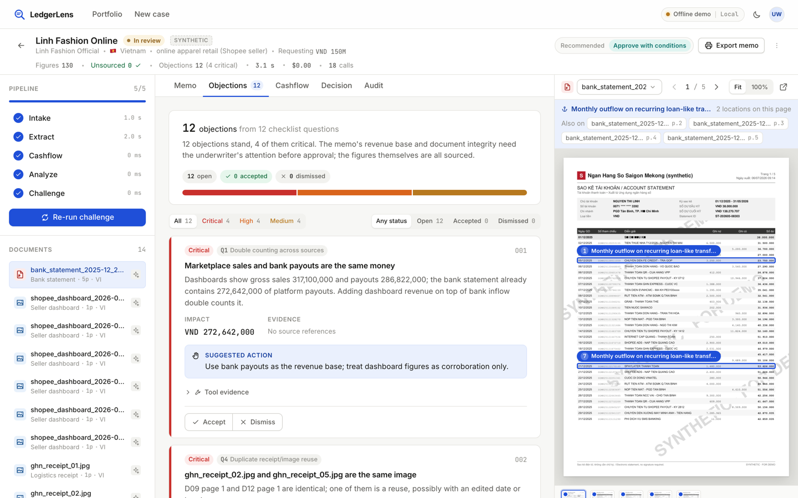
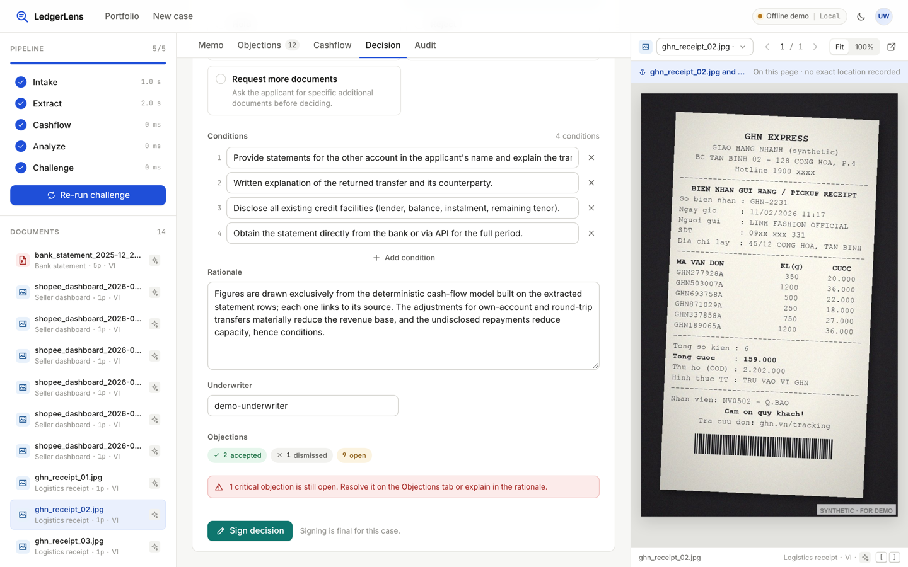
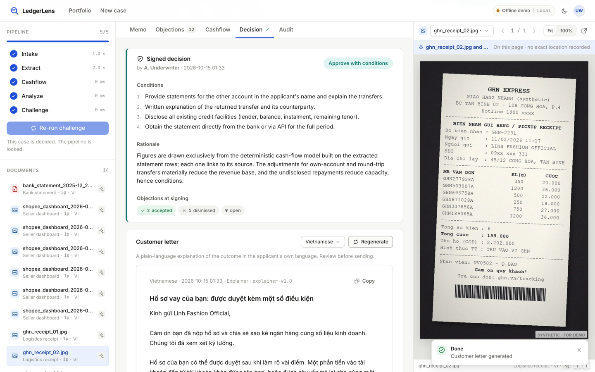

# LedgerLens

**The first credit memo where every number can be clicked back to its source, and a second AI tries to break it before a human signs.**

LedgerLens is a loan-underwriting agent team for thin-file micro and small businesses in Southeast Asia. It reads
the unstructured evidence these businesses actually have (mobile-banking statement PDFs, Shopee seller-dashboard
screenshots, paper receipts, handwritten ledgers, shop photos) with Gemini's multimodal models, drafts a credit memo
in which **every figure carries a document id, page and bounding box**, then runs an independent **Challenger agent**
that adversarially tests the memo with deterministic tools. A human underwriter accepts or dismisses each objection and
signs the decision; the decision feeds back into the Challenger's priorities. AI Builder Cup 2026, BFSI track.

> Humans decide. AI shows its work.

## Demo



Full-resolution recording: [docs/media/ledgerlens_demo.mp4](docs/media/ledgerlens_demo.mp4) (40 s, offline demo mode on the synthetic case *Linh Fashion Online*: run the pipeline, click a memo figure to jump to its source row, accept and dismiss Challenger objections, sign the decision, generate the Vietnamese customer letter, review the audit trail).

| | |
|---|---|
|  Portfolio with pipeline state and objection severity per case |  Credit memo: every value is a sourced figure |
|  Click a figure: the statement page opens with the source rows highlighted |  Challenger objections with tool evidence and accept / dismiss |
|  Underwriter decision with open-critical warning and conditions |  Signed decision and plain-language customer letter |

More: [objection evidence](docs/media/07_objection_evidence.png) · [audit trail](docs/media/10_audit_trail.png) · [workbench before run](docs/media/02_workbench_before_run.png) · [pitch deck (PDF)](presentation/LedgerLens_AI_Builder_Cup_Submission.pdf)

## What makes it different

| Mechanism | How it works |
|---|---|
| **Evidence linking** | Extractor agents output JSON whose schema *requires* a `source {doc_id, page, bbox}` on every value. A deterministic Python module turns rows into a *figure catalog*; the Analyst can only cite catalog ids (`{fig:CF.avg_monthly_business_inflow}`), so a number without evidence cannot enter the memo. Clicking a number in the UI opens the page with the source highlighted. |
| **Text-layer cross-check** | Born-digital statement PDFs carry a text layer. We never extract from it (layouts vary), but we use it as a free oracle: every amount the model read must occur verbatim on the page it cited, and the bounding box must cover those words. Match rates are stored with the extraction and a miss becomes a Challenger objection. |
| **Challenger agent** | A separate ADK agent that never sees the Analyst's prompt. A deterministic battery runs first (balance continuity, perceptual-hash image reuse incl. past cases, period cross-checks, self-transfer / round-trip / recurring-debt detectors, entity and currency consistency, unsourced-number scan); the agent then investigates 12 fixed questions with tools and writes severity-ranked objections. Tool-proven findings are guaranteed to surface. |
| **Decisions become data** | Accept/dismiss per objection and the signed outcome are stored with a full audit log (every agent call logged with model and prompt version). Acceptance rates per question re-weight the Challenger on the next case. |
| **Benchmark vs a single prompt** | 3 synthetic businesses with 20 planted traps (`data/synth/traps.json`). The same documents run through one "read everything and write a memo" prompt as the baseline. See `benchmark/results/REPORT.md`. |

## Architecture

```
Browser (React/Vite, Firebase Hosting) ──/api──> Cloud Run (FastAPI)
                                                   ├─ ADK agents: Intake · Extractor×5 · Analyst · Challenger(investigator→writer) · Explainer
                                                   ├─ Deterministic tools: compute_cashflow · recompute_balance_chain · image_similarity · date_crosscheck · entity checks
                                                   ├─ Firestore: cases · extractions · memos · objections · decisions · audit · traces · LLM cache
                                                   └─ Cloud Storage: original documents, page renders
Models: Gemini 3.8 Flash for every agent in budget mode (current default). Production tiering is a config switch: LEDGERLENS_MODEL_PRO=gemini-3.1-pro-preview moves Extractor (statements, ledgers), Analyst and Challenger to Pro; Intake and Explainer stay on Flash.
No separate OCR engine: PDF pages and photos are rendered to images and read by Gemini, which returns values with page coordinates.
```

Pipeline: `upload → intake → extract → cashflow (Python) → analyze → challenge → human decision → customer letter`.

## Repository layout

```
backend/        FastAPI + ADK agents (app/agents), deterministic tools (app/tools), storage (local JSON or Firestore+GCS)
frontend/       React workbench: memo viewer with clickable figures, document viewer with bbox highlights, objection cards, decision panel, audit
data/synth/     Synthetic dataset generator, 3 cases, traps.json answer key (no real data; every file watermarked SYNTHETIC)
benchmark/      run_benchmark.py (LedgerLens vs single-prompt baseline), results/
deploy/         deploy.sh for Cloud Run (+ Firebase Hosting), launch config
docs/API.md     REST contract
LEDGERLENS_PLAN.md  product plan (Korean working document)
```

## Run locally

```bash
# backend (Python 3.12). Without GOOGLE_API_KEY it runs in *mock* mode: full pipeline, answers from the synthetic answer key.
cd backend && uv venv --python 3.12 .venv && uv pip install --python .venv/bin/python -r requirements.txt
cp ../.env.example ../.env          # add GOOGLE_API_KEY=... for live Gemini calls
.venv/bin/uvicorn app.main:app --port 8080 --reload

# frontend
cd frontend && npm install && npm run dev      # http://localhost:5173 (proxies /api to :8080)

# regenerate synthetic data / run tests / benchmark
backend/.venv/bin/python data/synth/generate.py --seed 7 --out cases && backend/.venv/bin/python data/synth/verify.py
cd backend && .venv/bin/python -m pytest -q
backend/.venv/bin/python benchmark/run_benchmark.py
```

Open the app, click **Load demo cases**, open *Linh Fashion Online* (case B), press **Run all**, then click any number in the memo.

### LLM modes
| `LEDGERLENS_LLM_MODE` | Behaviour |
|---|---|
| `auto` (default) | live Gemini when a key is present, otherwise mock |
| `live` | call Gemini; responses are cached by content hash (model + prompt version + inputs) so re-runs are free and deterministic |
| `cache_only` | never call Gemini; a cache miss returns 503. Use for the public demo instance |
| `mock` | offline; answers come from the synthetic answer key |

## Cost (budget mode)

Everything defaults to **Gemini 3.8 Flash** (free tier available; paid USD 0.75 / 3.75 per 1M tokens) and the whole case
is cached after the first run. A full run of a 20-document case is roughly 60-90k input and 15-25k output tokens, i.e. about
**USD 0.10 per case** on paid Flash, USD 0 on the free tier. Cloud Run scales to zero (free tier covers the evaluation
traffic), Firestore and Cloud Storage stay far inside their free quotas. `LEDGERLENS_BUDGET_CAP_USD` (default 5) makes the
service refuse further Gemini calls once the process has spent that much. Setting `MIN_INSTANCES=1` to avoid cold starts
costs ~USD 10+/month and is therefore **off** by default.

## Deploy

```bash
export PROJECT_ID=your-project REGION=asia-southeast1
echo -n "$GOOGLE_API_KEY" | gcloud secrets create gemini-api-key --data-file=-
./deploy/deploy.sh                       # Cloud Run from source (Dockerfile builds the frontend too, served at /)
DEPLOY_FIREBASE=1 ./deploy/deploy.sh     # additionally publish the frontend on Firebase Hosting with /api rewritten to Cloud Run
```

## Synthetic data and limits

No real customer data is used anywhere. The three businesses, their statements, dashboards, receipts, ledgers and
premises images are generated by `data/synth/generate.py`; every page carries a visible "SYNTHETIC · FOR DEMO" watermark.
The 20 traps come from real underwriting checklists (double counting, round-tripping, document reuse, period and balance
inconsistencies, hidden debt). LedgerLens does not produce a credit score and does not price loans; it organises evidence
for a human decision.

## Benchmark

See `benchmark/results/REPORT.md` (generated by `benchmark/run_benchmark.py`). Metrics: trap recall (target >= 16/20),
unsourced numbers (target 0), objections on the clean case, extraction row accuracy, evidence-link accuracy, time and
cost per case, each compared with the single-prompt baseline.

## License

MIT for the code in this repository. Synthetic data is free to reuse with attribution.
